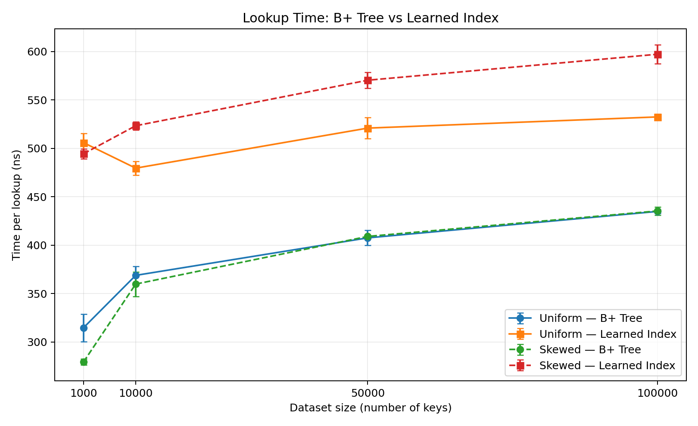

# Learned Index vs B+ Tree

### Can Machine Learning Models Replace B+ Trees for Lookups?

This project explores whether a machine learning-based index can be an alternative to a traditional B+ Tree for searching data.

We implemented two indexing approaches in Python:

- **B+ Tree:** A traditional tree-based indexing structure.
- **Learned Index:** Uses linear regression to predict where a key is located, followed by binary search to find its exact position.

The goal is to compare their lookup performance, memory usage, and insertion overhead across different dataset sizes and distributions.

## Project Structure

```text
learned-index-structure/
├── src/
│   ├── indexes.py
│   ├── benchmark.py
│   └── test_correctness.py
├── results/
│   ├── measurements.csv
│   ├── final_run_1.csv
│   ├── final_run_2.csv
│   ├── final_run_3.csv
│   └── benchmark_summary.csv
├── graphs/
│   ├── lookup_time.png
│   ├── insertion_time.png
│   ├── build_peak_memory.png
│   └── prediction_error.png
├── analyze_results.py
├── verify.py
└── README.md
```

## Getting Started

**Requirements:** Python 3.9+ and Matplotlib (for generating graphs).

Clone the repository:

```bash
git clone https://github.com/anmol-it25/learned-index-structure.git
cd learned-index-structure
```

Run the benchmark:

```bash
python3 src/benchmark.py --sizes 1000 10000 50000 100000 --lookups 5000 --updates 10
```

This saves the measurements to `results/measurements.csv`.

Verify lookup correctness:

```bash
python3 src/test_correctness.py
```

Generate graphs:

```bash
python3 -m pip install matplotlib
python3 analyze_results.py
```

The graphs are saved in `graphs/`, and the summary table is saved in `results/benchmark_summary.csv`.

## Experiments

We tested both indexes using:

- Uniform and skewed datasets
- Dataset sizes from 1,000 to 100,000 keys
- 5,000 lookup queries per configuration
- Three complete benchmark runs

The experiments measure lookup time, insertion time, peak memory allocation during construction, and prediction error.

## Results

The B+ Tree achieved faster lookups across all tested configurations, while the Learned Index showed lower peak memory allocation during construction.

The learned model also had higher insertion overhead because it is refitted after each insertion.



The full measurements and additional comparison graphs are available in the `results/` and `graphs/` folders.

## Notes

This is an educational Python implementation, not a production database benchmark.

The learned index uses an optimized binary-search correction, while the B+ Tree is implemented in Python. This difference, along with Python overhead and in-memory testing, should be considered when interpreting the results.

The memory measurements represent peak allocations during construction, not exact retained index memory.

## Reference

Kraska et al. (2018), *The Case for Learned Index Structures*, SIGMOD.

## License

This project is licensed under the MIT License. See [LICENSE](LICENSE).
